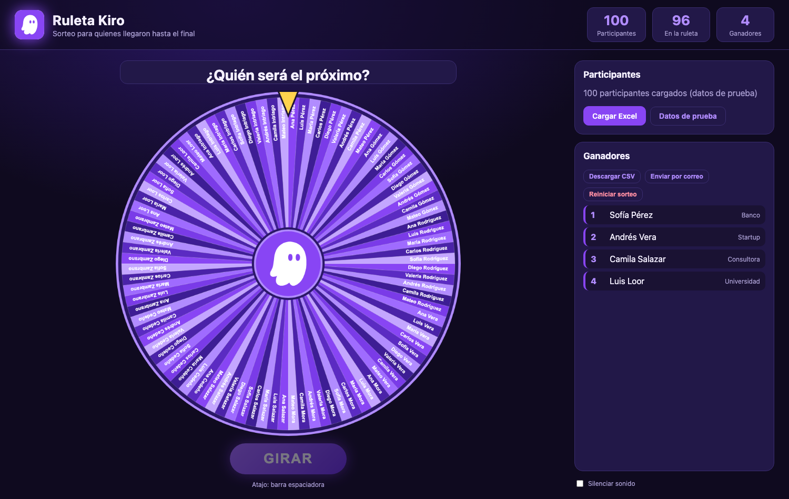

# Ruleta Kiro 🎡👻

Ruleta para sortear entre quienes respondieron una encuesta en un evento. Cada giro elige un ganador y lo saca de la ruleta, así nadie sale dos veces.

> **EN:** A browser-based raffle wheel for events. Load an Excel/CSV of survey respondents, spin, and each winner is removed from the wheel so nobody wins twice. No backend, no install, no data leaves your browser.

## Uso rápido

1. Abre `index.html` en el navegador (doble clic). Funciona sin internet.
2. Carga tu Excel con **Cargar Excel** o arrastrándolo a la página. Para ensayar, usa **Datos de prueba**.
3. Pulsa **GIRAR** (o la barra espaciadora).
4. En el recuadro del ganador:
   - **Confirmar**: queda registrado y sale de la ruleta.
   - **No está presente**: sale de la ruleta sin contarse como ganador, y vuelves a girar.
5. Al final, **Descargar CSV** o **Enviar por correo** (descarga el CSV y abre tu cliente de correo con el resumen; adjunta el CSV tú mismo).

Para publicarla como sitio, activa GitHub Pages sobre esta carpeta. Es 100 % estática.

## Formato del Excel

Primera fila con encabezados, detectados por nombre. Solo el nombre es obligatorio.

| Dato | Encabezados reconocidos | Uso |
|---|---|---|
| Nombre | `Nombre`, `Name`, `Participante` | Se muestra en la ruleta |
| Apellido | `Apellido` | Se une al nombre |
| Empresa | `Empresa/Institución`, `Empresa`, `Institución` | Se muestra junto al ganador |
| Correo | `Correo`, `Email` | Evita duplicados (misma persona respondiendo dos veces) |
| Manilla | `Manilla`, `Pulsera`, `Número`, `Ticket` | Se muestra junto al ganador, si existe |

Las demás columnas (por ejemplo `Feedback`) se ignoran. Sin encabezados reconocibles, se usa la primera columna como nombre. Las filas vacías y los duplicados se ignoran.

## Cómo elige al ganador

El ganador se decide **antes** de animar la ruleta, con `crypto.getRandomValues` y sin sesgo de módulo. La animación solo está calculada para detenerse sobre ese ganador. Con 100 participantes cada uno tiene la misma probabilidad.

## Privacidad

- Todo corre en tu navegador. El Excel se lee localmente y no se sube a ningún servidor.
- El estado (lista y ganadores) se guarda en el `localStorage` de tu navegador para sobrevivir a una recarga. **Reiniciar sorteo** devuelve a todos a la ruleta, y cargar otra lista borra la anterior.
- `.gitignore` excluye `*.xlsx`, `*.csv` y `participantes*` para que no subas datos reales por accidente.

## Archivos

| Archivo | Qué es |
|---|---|
| `index.html`, `style.css`, `app.js` | La aplicación |
| `kiro.svg` | Logo del centro de la ruleta (reemplázalo por el tuyo si lo prefieres) |
| `xlsx.full.min.js` | [SheetJS](https://sheetjs.com) 0.18.5 (Apache-2.0), lector de Excel incluido para funcionar sin internet |

## Construido con Kiro

Esta app se construyó conversando con [Kiro](https://kiro.dev): desde el pedido inicial ("una ruleta con mi lista de Excel, que descarte a quien ya ganó") hasta la interfaz, la lectura del Excel y el botón de correo. Las pruebas incluyeron un navegador sin ventana para revisar el dibujo y una simulación de 100 giros seguidos para comprobar que no se repite ningún ganador.

El logo de Kiro es una marca de Amazon Web Services; este proyecto es independiente y no está afiliado ni respaldado por AWS.

## Autor

**Hernán Villavicencio** · AWS User Group Quito · [linkedin.com/in/hvillavicencio](https://linkedin.com/in/hvillavicencio)

## Licencia

[MIT](LICENSE)
